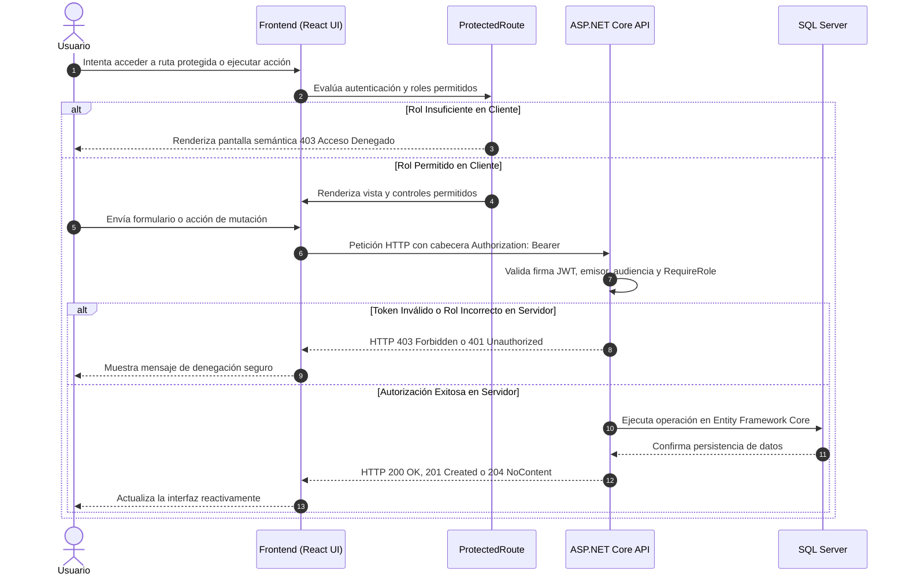

# 📄 Informe Técnico de Arquitectura y Seguridad
## Trabajo Práctico Nº 2: Lenguaje de Programación Web II (LPW2)

---

## 1. Justificación de la Arquitectura del Frontend

La aplicación cliente de **VetCare** fue diseñada siguiendo los principios de alta cohesión, bajo acoplamiento y separación estricta de responsabilidades (*Separation of Concerns*). La estructura del proyecto se organiza por capas funcionales dentro de `src/`:

```text
src/
├── api/          # Configuración e interceptores de red HTTP
├── components/   # Componentes reutilizables, accesibles y atómicos de UI
├── context/      # Estado global de autenticación, RBAC y sesión
├── hooks/        # Capa de consumo asíncrono con TanStack Query
├── pages/        # Vistas de la aplicación ensambladas
├── routes/       # Definición de rutas protegidas y públicas
├── schemas/      # Esquemas de validación Zod desacoplados
├── services/     # Llamadas HTTP tipadas hacia la API
├── types/        # Definiciones de tipos TypeScript del contrato de API
└── utils/        # Utilidades puras (almacenamiento de tokens, validación RUT)
```

### A. Cliente Axios Centralizado con Interceptores
En lugar de dispersar llamadas `fetch` o `axios` en los componentes, se implementó una instancia singleton en `src/api/client.ts`. Esta abstracción ofrece:
1. **Inyección transparente de credenciales:** Mediante un interceptor de petición (*request interceptor*), cada solicitud saliente adjunta automáticamente la cabecera `Authorization: Bearer <token>` cuando el usuario posee una sesión activa.
2. **Normalización de errores de red:** El interceptor de respuesta captura fallos de red, códigos de estado HTTP y errores de validación de ASP.NET Core (`ValidationProblemDetails`), transformándolos en un contrato unificado `ApiValidationError`.
3. **Manejo defensivo de expiración de sesión (HTTP 401):** Ante una respuesta `401 Unauthorized`, el interceptor purga inmediatamente el token del almacenamiento local, desautentica al usuario en el contexto global y ejecuta una redirección segura hacia `/login`.
4. **Manejo de conflictos de clave foránea (HTTP 409):** Intercepta respuestas de violación referencial generadas por la base de datos, notificando al usuario mediante mensajes comprensibles en lugar de interrumpir el flujo.

### B. Manejo de Estado Asíncrono con TanStack Query v5
El manejo de datos provenientes del servidor se desacopla del ciclo de vida tradicional de los componentes (`useEffect` + `useState`), delegándolo en `@tanstack/react-query`:
- **Caché declarativa:** Las consultas (`useQuery`) almacenan las listas de clientes, pacientes, citas y facturas en memoria, eliminando solicitudes redundantes al navegar entre pantallas.
- **Precarga proactiva (Prefetching):** En la barra de navegación, eventos `onMouseEnter` y `onFocus` disparan la precarga de consultas antes de que el usuario haga clic, reduciendo la latencia percibida a cero.
- **Invalidación dirigida de caché:** Tras mutaciones exitosas (`useMutation` en creación, edición o eliminación), la clave de caché correspondiente se invalida de forma inmediata (`queryClient.invalidateQueries`), desencadenando una sincronización automática en segundo plano.
- **Gestión nativa de estados de interfaz:** TanStack Query expone de forma canónica las banderas `isLoading`, `isError`, `data` e `isFetching`, permitiendo implementar con precisión los estados requeridos (Carga con esqueletos, Error con reintento, Estado vacío y Datos).

---

## 2. Estrategia de Almacenamiento y Ciclo de Vida del JWT

### A. Justificación Técnica del Almacenamiento en Cliente
En arquitecturas SPA desacopladas donde el backend y el frontend residen en orígenes distintos (Cross-Origin: `http://localhost:5173` y `https://localhost:7189`), existen dos estrategias principales para gestionar credenciales JWT:

1. **Cookies `HttpOnly` con flag `SameSite`:** Ofrecen alta protección contra lectura directa de JavaScript, pero introducen complejidad en configuraciones locales de orígenes cruzados (requieren sincronización de dominios y políticas `SameSite=None; Secure`) y son vulnerables a ataques Cross-Site Request Forgery (CSRF).
2. **Almacenamiento en Cliente (`sessionStorage` / `localStorage`) con Cabecera Bearer:** Seleccionada para este proyecto debido a su idoneidad en APIs REST desacopladas sin estado (*stateless*). El token se transmite explícitamente en la cabecera `Authorization`, lo que **inmuniza naturalmente a la aplicación contra ataques CSRF**, ya que los navegadores nunca adjuntan automáticamente cabeceras personalizadas en solicitudes de orígenes cruzados.

### B. Mitigación de Riesgos de Persistencia
Para mitigar el riesgo intrínseco de acceso a almacenamiento por posibles scripts maliciosos (XSS):
- **Cero inyección HTML no controlada:** La aplicación React utiliza renderizado declarativo nativo basado en JSX, el cual escapa automáticamente cualquier cadena de texto previa a su inserción en el DOM, anulando la posibilidad de ejecución de scripts en línea.
- **Vida útil acotada del token:** El backend emite tokens JWT configurados mediante `Jwt:ExpireMinutes` (60 minutos por defecto), limitando la ventana de utilidad en caso de filtración accidental.
- **Control de inactividad en cliente:** El contexto `AuthContext` incorpora un temporizador de inactividad que purga automáticamente la sesión si el usuario no registra actividad durante 3 minutos.
- **Purga de sesión preventiva:** Cualquier respuesta HTTP 401 o cierre de sesión manual limpia exhaustivamente el almacenamiento (`tokenStorage.clear()`), impidiendo la reutilización de credenciales obsoletas.

---

## 3. Control de Acceso por Roles (RBAC en Dos Niveles)

El sistema aplica el principio de defensa en profundidad (*Defense in Depth*) implementando autorización en dos capas complementarias:



### Capa 1: Experiencia de Usuario en el Cliente (UI Defense)
- **`ProtectedRoute.tsx`:** Componente de envoltura que inspecciona los claims del JWT (`ClaimTypes.Role`). Si el usuario no cuenta con el rol requerido (por ejemplo, un `Recepcionista` intentando acceder a una ruta de `Administrador`), el enrutador bloquea el renderizado y muestra una vista semántica de *403 Acceso Denegado*.
- **Renderizado condicional de acciones:** En las vistas `ClientesPage`, `PacientesPage`, `CitasPage` y `FacturacionPage`, los botones de mutación crítica (crear, editar, eliminar) se ocultan o inhabilitan dinámicamente si el rol del usuario carece de permisos (`canWrite`, `canDelete`).

### Capa 2: Barrera Infranqueable en el Servidor (API Enforcement)
El cliente nunca es la autoridad final de seguridad. Todos los endpoints de ASP.NET Core aplican políticas declarativas estrictas mediante Minimal APIs:
- `GET /api/v1/clientes`: `.RequireRole("Administrador", "Veterinario", "Recepcionista")`
- `POST /api/v1/clientes`: `.RequireRole("Administrador", "Veterinario")`
- `PUT /api/v1/clientes/{id}`: `.RequireRole("Administrador", "Veterinario")`
- `DELETE /api/v1/clientes/{id}`: `.RequireRole("Administrador")`
- `GET /api/v1/citas`: `.RequireRole("Administrador", "Veterinario", "Recepcionista")`
- `POST /api/v1/citas`: `.RequireRole("Administrador", "Veterinario", "Recepcionista")`
- `DELETE /api/v1/citas/{id}`: `.RequireRole("Administrador", "Veterinario")`
- `GET /api/v1/usuarios`: `.RequireRole("Administrador")`
- `POST /api/v1/usuarios/register`: `.RequireRole("Administrador")`

Si un usuario elude las restricciones visuales y envía solicitudes manuales directas, el backend rechaza la petición con `HTTP 403 Forbidden`.

---

## 4. Accesibilidad WCAG 2.2 AA y Diseño Responsivo Mobile-First

La interfaz gráfica fue construida bajo las directrices del **W3C Web Content Accessibility Guidelines (WCAG) 2.2 Nivel AA**:

### A. Medidas de Accesibilidad Implementadas
1. **HTML Semántico y Asociación Label-Input (Criterio 1.3.1, 4.1.2):**
   - El componente `InputField.tsx` vincula cada `<label>` con su `<input>` mediante los atributos `htmlFor` e `id`.
   - Cuando se presentan errores de validación, el input recibe `aria-invalid="true"` y se enlaza mediante `aria-describedby` al párrafo con `role="alert"`, garantizando que el lector de pantalla anuncie inmediatamente la naturaleza del error.
2. **Gestión de Foco y Trampas de Foco en Modales (Criterio 2.4.3):**
   - El componente `ConfirmDialog.tsx` implementa el patrón modal accesible: utiliza `role="dialog"`, `aria-modal="true"` y `aria-labelledby`.
   - Incluye una trampa de foco (*focus trap*) por teclado mediante listeners de `keydown (Tab / Shift + Tab)` que impiden que el foco escape fuera del modal mientras esté abierto.
   - Permite el cierre accesible mediante la tecla `Escape` y restaura el foco al botón disparador original al cerrarse el diálogo.
3. **Áreas de Toque Mínimas (Criterio 2.5.8 Target Size - Minimum):**
   - Todos los elementos interactivos (botones de acción, iconos de eliminar, editar, ver detalle y controles de navegación) poseen una dimensión táctil mínima de 44x44 píxeles (`min-h-[44px] min-w-[44px]`).
4. **Indicadores de Foco Visibles y Contraste de Colores (Criterio 2.4.7, 1.4.3):**
   - Se aplicó la clase `focus-visible:ring-2` y `focus-visible:ring-offset-2` con colores de alto contraste sobre todos los elementos interactivos.
   - La paleta de colores de texto y fondo supera la relación de contraste de 4.5:1 en texto normal (y 7:1 en encabezados).
5. **Idioma del Documento (Criterio 3.1.1):**
   - El documento principal `index.html` declara explícitamente `lang="es"`, asegurando que los motores de síntesis de voz de lectores de pantalla utilicen la fonética adecuada en español.

### B. Diseño Mobile-First y Adaptabilidad desde 320 px
- **Vista Móvil (menor a 768 px):** Los registros se renderizan como tarjetas individuales estructuradas (`<ul>` y `<li>`), evitando el desbordamiento o scroll horizontal en pantallas desde 320 px de ancho.
- **Vista de Escritorio (768 px o más):** Los registros se transforman en una tabla semántica (`<table>`, `<caption>`, `<thead>`, `<th>` con `scope="col"` y `<tbody>`).
- **Enlace de salto:** Se implementó un enlace *"Saltar al contenido principal"* (`href="#main-content"`) visible únicamente al enfocar con el teclado.

---

## 5. Matriz de Seguridad OWASP

La siguiente matriz documenta la mitigación formal de al menos 5 riesgos críticos del OWASP Top 10, con énfasis en vulnerabilidades del lado del cliente y su verificación en ejecución:

| Riesgo de Seguridad | Referencia OWASP | Ubicación en el Código | Mitigación Técnica Aplicada | Cómo Verificar Ejecutando el Proyecto |
| :--- | :--- | :--- | :--- | :--- |
| **Cross-Site Scripting (XSS)** *(Lado Cliente)* | OWASP A03:2021: Injection | `veterinaria-client/src/` (Formularios y componentes UI) | React utiliza interpolación JSX segura que escapa automáticamente caracteres especiales (`<`, `>`, `&`, `"`, `'`). No se utiliza `dangerouslySetInnerHTML`. Validación estricta con Zod en inputs. | Ingrese `<script>alert(1)</script>` en el buscador de Clientes; observe que se renderiza como texto plano sin ejecutar alerta. También validado en Playwright: `npm run test:e2e`. |
| **Broken Access Control (Escalada de Privilegios)** *(Lado Cliente y Servidor)* | OWASP A01:2021: Broken Access Control | `veterinaria-client/src/routes/ProtectedRoute.tsx` y `VeterinariaAPI/Endpoints/` | Doble barrera de autorización: `ProtectedRoute` en cliente y `.RequireRole(...)` en servidor para operaciones de escritura y eliminación (`DELETE`). | Inicie sesión como Recepcionista y envíe `curl -k -i -X DELETE https://localhost:7189/api/v1/clientes/1 -H "Authorization: Bearer <TOKEN>"`. El servidor responderá con HTTP 403 Forbidden. En suite xUnit: `dotnet test`. |
| **Authentication Failures (Fuerza Bruta y Cuentas Demo)** *(Lado Servidor)* | OWASP A07:2021: Identification & Authentication Failures | `VeterinariaAPI/Program.cs` (`AuthPolicy`), `AuthService.cs` y `DbSeeder.cs` | Rate limiting por IP en `/api/v1/usuarios/login` (5 peticiones por minuto). Contraseñas protegidas exclusivamente con hash BCrypt. Se eliminaron contraseñas fijas hardcodeadas de demostración. | Ejecute 6 intentos seguidos de login fallido mediante script o PowerShell; la 6ª petición devolverá HTTP 429 Too Many Requests. En suite xUnit: `dotnet test`. |
| **Cross-Site Request Forgery (CSRF)** *(Lado Cliente)* | OWASP A01:2021 / A05:2021 | `veterinaria-client/src/api/client.ts` y `VeterinariaAPI/Program.cs` | Arquitectura basada en tokens JWT transmitidos vía cabecera `Authorization: Bearer`. Los navegadores nunca adjuntan cabeceras personalizadas automáticamente en peticiones cross-site, neutralizando ataques CSRF. | Inspeccione en la pestaña Network de DevTools cualquier petición hacia la API; confirme que viaja con la cabecera `Authorization: Bearer <JWT>` y no mediante cookies de sesión tradicionales. |
| **Security Misconfiguration (Cabeceras HTTP y Fuga de Errores)** *(Lado Servidor y Cliente)* | OWASP A05:2021: Security Misconfiguration | `VeterinariaAPI/Program.cs` y `GlobalExceptionMiddleware.cs` | Inyección garantizada de cabeceras de protección: `X-Content-Type-Options: nosniff`, `X-Frame-Options: DENY`, `Referrer-Policy` y `Permissions-Policy`. Respuestas de error 500 genéricas sin filtrar rutas internas ni detalles de base de datos. | Envíe `curl -k -i https://localhost:7189/api/v1/clientes` y compruebe las cabeceras HTTP de respuesta. Envíe una petición a `https://localhost:7189/api/test-error` y compruebe que no expone el mensaje interno de la excepción. |
