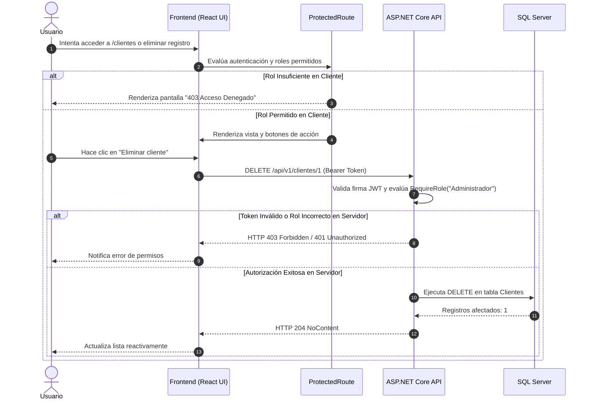

# 📄 Informe Técnico de Arquitectura y Seguridad
## Trabajo Práctico Nº 2: Lenguaje de Programación Web II (LPW2)

---

## 1. Justificación de la Arquitectura del Frontend

La aplicación cliente de **VetCare** fue diseñada siguiendo los principios de alta cohesión, bajo acoplamiento y separación estricta de responsabilidades (*Separation of Concerns*). La estructura del proyecto se organiza por capas funcionales dentro de `src/`:

```text
src/
├── api/          # Configuración e interceptores de red HTTP
├── components/   # Componentes reutilizables, accesibles y atómicos de UI
├── context/      # Estado global de autenticación y sesión
├── hooks/        # Capa de consumo asíncrono con TanStack Query
├── pages/        # Vistas de la aplicación ensambladas
├── routes/       # Definición de rutas protegidas y públicas
├── schemas/      # Esquemas de validación Zod desacoplados
├── services/     # Llamadas HTTP tipadas hacia la API
├── types/        # Definiciones de tipos TypeScript del contrato de API
└── utils/        # Utilidades puras (almacenamiento de tokens, formateo)
```

### A. Cliente Axios Centralizado con Interceptores
En lugar de dispersar llamadas `fetch` o `axios` en los componentes, se implementó una instancia singleton en `src/api/client.ts`. Esta abstracción ofrece:
1. **Inyección transparente de credenciales:** Mediante un interceptor de petición (*request interceptor*), cada solicitud saliente adjunta automáticamente la cabecera `Authorization: Bearer <token>` cuando el usuario posee una sesión activa.
2. **Normalización de errores de red:** El interceptor de respuesta captura fallos de red, códigos de estado HTTP y errores de validación de ASP.NET Core (`ValidationProblemDetails`), transformándolos en un contrato unificado `ApiValidationError`.
3. **Manejo defensivo de expiración de sesión (HTTP 401):** Ante una respuesta `401 Unauthorized`, el interceptor purga inmediatamente el token del almacenamiento local, desautentica al usuario en el contexto global y ejecuta una redirección segura hacia `/login` preservando la ruta de origen en el estado de navegación.

### B. Manejo de Estado Asíncrono con TanStack Query v5
El manejo de datos provenientes del servidor se desacopla del ciclo de vida tradicional de los componentes (`useEffect` + `useState`), delegándolo en `@tanstack/react-query`:
- **Caché declarativa:** Las consultas (`useQuery`) almacenan las listas de clientes y pacientes en memoria, eliminando solicitudes redundantes al navegar entre pantallas.
- **Invalidación dirigida de caché:** Tras mutaciones exitosas (`useMutation` en `useCreateCliente`, `useUpdateCliente`, `useDeleteCliente`), la clave de caché `['clientes']` o `['pacientes']` se invalida automáticamente (`queryClient.invalidateQueries`), desencadenando un refresco silencioso en segundo plano sin recargar la página.
- **Gestión nativa de estados de interfaz:** TanStack Query expone de forma canónica las banderas `isLoading`, `isError`, `data` e `isFetching`, permitiendo implementar con precisión los 4 estados requeridos por la rúbrica (Carga, Error con reintento, Estado vacío y Datos).

---

## 2. Estrategia de Almacenamiento y Ciclo de Vida del JWT

### A. Justificación Técnica del Almacenamiento en Cliente
En arquitecturas SPA desacopladas donde el backend y el frontend residen en orígenes distintos (Cross-Origin: `http://localhost:5173` y `https://localhost:7189`), existen dos estrategias principales para gestionar credenciales JWT:

1. **Cookies `HttpOnly` con flag `SameSite`:** Ofrecen alta protección contra ataques XSS al ser inaccesibles para el motor de JavaScript, pero introducen complejidad en configuraciones Cross-Origin locales (requieren sincronización de dominios, políticas `SameSite=None; Secure` y certificados SSL válidos en desarrollo) y son susceptibles a ataques Cross-Site Request Forgery (CSRF).
2. **Almacenamiento en Cliente (`sessionStorage` / `localStorage`) con Cabecera Bearer:** Seleccionada para este proyecto debido a su idoneidad en APIs REST desacopladas sin estado (*stateless*). El token se transmite explícitamente en la cabecera `Authorization`, lo que **inmuniza naturalmente a la aplicación contra ataques CSRF**, ya que los navegadores nunca adjuntan automáticamente cabeceras personalizadas en solicitudes de orígenes cruzados.

### B. Mitigación de Riesgos de Persistencia
Para mitigar el riesgo intrínseco de acceso a almacenamiento por posibles scripts maliciosos (XSS):
- **Cero inyección HTML no controlada:** La aplicación React utiliza renderizado declarativo nativo basado en JSX, el cual escapa automáticamente cualquier cadena de texto previa a su inserción en el DOM, anulando la posibilidad de ejecución de scripts en línea.
- **Vida útil acotada del token:** El backend emite tokens JWT con un tiempo de expiración corto (`Jwt:ExpireMinutes = 60`), limitando la ventana de utilidad en caso de filtración.
- **Purga de sesión preventiva:** Cualquier respuesta HTTP 401 o cierre de sesión manual limpia exhaustivamente el almacenamiento (`tokenStorage.clear()`), impidiendo la reutilización de credenciales obsoletas.

---

## 3. Control de Acceso por Roles (RBAC en Dos Niveles)

El sistema aplica el principio de defensa en profundidad (*Defense in Depth*) implementando autorización en dos capas complementarias:



### Capa 1: Experiencia de Usuario en el Cliente (UI Defense)
- **`ProtectedRoute.tsx`:** Componente de envoltura que inspecciona los claims del JWT (`ClaimTypes.Role`). Si el usuario no cuenta con el rol requerido (por ejemplo, un `Recepcionista` intentando acceder a una ruta exclusiva de `Administrador`), el enrutador bloquea el renderizado y muestra una vista semántica de *403 Acceso Denegado*.
- **Renderizado condicional de acciones:** En las vistas `ClientesPage` y `PacientesPage`, los botones de mutación crítica (crear, editar, eliminar) se ocultan o inhabilitan dinámicamente si el rol del usuario carece de permisos de escritura (`canWrite`, `canDelete`).

### Capa 2: Barrera Infranqueable en el Servidor (API Enforcement)
El cliente nunca es la autoridad final de seguridad. Todos los endpoints de ASP.NET Core aplican políticas declarativas estrictas mediante Minimal APIs:
- `GET /api/v1/clientes`: `.RequireRole("Administrador", "Veterinario", "Recepcionista")`
- `POST /api/v1/clientes`: `.RequireRole("Administrador", "Veterinario")`
- `PUT /api/v1/clientes/{id}`: `.RequireRole("Administrador", "Veterinario")`
- `DELETE /api/v1/clientes/{id}`: `.RequireRole("Administrador")`

Si un usuario malicioso elude las restricciones de la interfaz frontend y envía solicitudes manuales (mediante cURL o Postman), el backend rechazará la petición con `HTTP 403 Forbidden`.

---

## 4. Accesibilidad WCAG 2.2 AA y Diseño Responsivo Mobile-First

La interfaz gráfica fue construida bajo las directrices del **W3C Web Content Accessibility Guidelines (WCAG) 2.2 Nivel AA**:

### A. Medidas de Accesibilidad Implementadas
1. **HTML Semántico y Asociación Label-Input (Criterio 1.3.1, 4.1.2):**
   - El componente `InputField.tsx` vincula inequívocamente cada `<label>` con su `<input>` mediante los atributos `htmlFor` e `id`.
   - Cuando se presentan errores de validación, el input recibe `aria-invalid="true"` y se enlaza mediante `aria-describedby` al párrafo con `role="alert"`, garantizando que el lector de pantalla anuncie inmediatamente la naturaleza del error.
2. **Gestión de Foco y Trampas de Foco en Modales (Criterio 2.4.3):**
   - El componente `ConfirmDialog.tsx` implementa el patrón modal accesible: utiliza `role="dialog"`, `aria-modal="true"` y `aria-labelledby`.
   - Incluye una trampa de foco (*focus trap*) por teclado mediante listeners de `keydown (Tab / Shift+Tab)` que impiden que el foco escape fuera del modal mientras esté abierto.
   - Permite el cierre accesible mediante la tecla `Escape`.
   - Restaura el foco al botón disparador original al cerrarse el diálogo.
3. **Áreas de Toque Mínimas (Criterio 2.5.8 Target Size - Minimum):**
   - Todos los elementos interactivos (botones de acción, iconos de eliminar, editar, ver detalle y controles de paginación) poseen una dimensión táctil mínima de $44 \times 44$ píxeles (`min-h-[44px] min-w-[44px]`).
4. **Indicadores de Foco Visibles y Contraste (Criterio 2.4.7, 1.4.3):**
   - Se aplicó la clase `focus-visible:ring-2` y `focus-visible:ring-offset-2` con colores de alto contraste sobre todos los elementos interactivos.
   - La paleta de colores de texto y fondo supera la relación de contraste de $4.5:1$ en texto normal.

### B. Diseño Mobile-First y Adaptabilidad desde 320 px
- **Vista Móvil (< 768 px):** Los registros se renderizan como tarjetas individuales estructuradas (`<ul>` y `<li>`), evitando el desbordamiento o scroll horizontal en pantallas desde 320 px de ancho.
- **Vista de Escritorio ($\ge 768$ px):** Los registros se transforman en una tabla semántica (`<table>`, `<caption>`, `<thead>`, `<th>` con `scope="col"` y `<tbody>`).
- **Enlace de salto:** Se implementó un enlace *"Saltar al contenido principal"* (`href="#main-content"`) visible únicamente al enfocar con el teclado.

---

## 5. Matriz de Seguridad OWASP

La siguiente matriz documenta la mitigación formal de al menos 5 riesgos críticos del OWASP Top 10 (con foco en vulnerabilidades del lado del cliente):

| Riesgo de Seguridad | Referencia OWASP | Ubicación en el Código | Mitigación Técnica Aplicada | Evidencia de Verificación |
| :--- | :--- | :--- | :--- | :--- |
| **Cross-Site Scripting (XSS)** | OWASP A03:2021: Injection | `veterinaria-client/src/` (Componentes y formularios) | React utiliza interpolación JSX segura que escapa automáticamente caracteres especiales (`<`, `>`, `&`, `"`, `'`). No se hace uso de `dangerouslySetInnerHTML`. Validación estricta con Zod en inputs. | Intentos de ingresar `<script>alert(1)</script>` se renderizan como texto plano inocuo; prueba automatizada en suite E2E. |
| **Broken Access Control (Escalada de Privilegios)** | OWASP A01:2021: Broken Access Control | `VeterinariaAPI/Endpoints/Clientes.cs` y `veterinaria-client/src/routes/ProtectedRoute.tsx` | Doble barrera de autorización: `ProtectedRoute` en cliente y `.RequireRole("Administrador")` obligatorio en servidor para operaciones destructivas (`DELETE`). | Prueba unitaria `ProtectedRoute.test.tsx` (403 Forbidden ante rol Recepcionista); test de integración en backend. |
| **Authentication Failures (Fuerza Bruta)** | OWASP A07:2021: Identification & Authentication Failures | `VeterinariaAPI/Program.cs` (`AuthPolicy`) y `Usuarios.cs` | Rate limiting por IP en endpoints `/api/v1/usuarios/login` y `/register`, limitando a 5 peticiones por minuto. Passwords hasheadas con `PasswordHasher<T>` (PBKDF2/SHA256). | Prueba xUnit `Test_RateLimiting_ExceedLimit_Returns429TooManyRequests` valida bloqueo con código HTTP 429 al 6º intento. |
| **Cross-Site Request Forgery (CSRF)** | OWASP A01:2021 / A05:2021 | `veterinaria-client/src/api/client.ts` y `VeterinariaAPI/Program.cs` | Arquitectura basada en tokens JWT transmitidos vía cabecera `Authorization: Bearer`. Los navegadores no adjuntan cabeceras personalizadas automáticamente en peticiones cross-site, neutralizando ataques CSRF. | Interceptor Axios configura la cabecera explícitamente en cada petición; verificado en tráfico HTTP. |
| **Security Misconfiguration (Falta de Cabeceras HTTP)** | OWASP A05:2021: Security Misconfiguration | `VeterinariaAPI/Program.cs` | Inyección de cabeceras HTTP de protección: `X-Content-Type-Options: nosniff`, `X-Frame-Options: DENY` (anti-clickjacking), `Referrer-Policy: strict-origin-when-cross-origin`. Política CORS restringida al origen frontend. | Inspección de cabeceras en respuestas HTTP (`curl -I` o DevTools); pruebas de integración xUnit confirman headers. |
