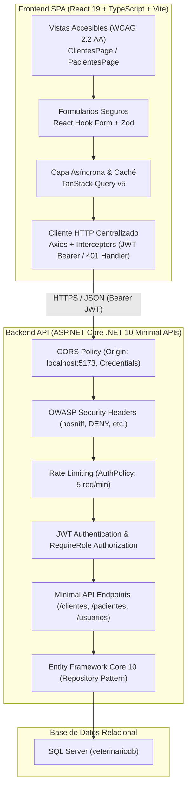

# 🐾 Sistema de Gestión Veterinaria (VetCare)
## Trabajo Práctico Nº 2 — Lenguaje de Programación Web II (LPW2)

[](https://dotnet.microsoft.com/)
[](https://react.dev/)
[](https://www.typescriptlang.org/)
[](https://vitejs.dev/)
[](https://tailwindcss.com/)
[](https://www.w3.org/WAI/standards-guidelines/wcag/)

Solución full-stack modular y desacoplada para la administración clínica de una veterinaria. El sistema implementa una API RESTful desarrollada con ASP.NET Core bajo el paradigma de Minimal APIs y un cliente Single Page Application (SPA) desarrollado con React, Vite, TypeScript y Tailwind CSS, enfocado en accesibilidad universal (WCAG 2.2 Nivel AA), seguridad OWASP y consumo HTTP asíncrono con TanStack Query.

---

## 🏗️ 1. Arquitectura del Sistema



### Componentes Clave:
- **Backend (`VeterinariaAPI`):**
  - .NET 10 Minimal APIs con patrón repositorio genérico (`IRepository<T>`).
  - Autenticación con JWT (JSON Web Tokens) firmados con algoritmo HMAC-SHA256 (`JwtSecurityToken`).
  - Control de acceso por roles (*Role-Based Access Control* - RBAC) en cada endpoint (`RequireRole("Administrador", "Veterinario", "Recepcionista")`).
  - Protección de fuerza bruta en autenticación con `RateLimiter` (`AuthPolicy`).
  - Cabeceras de seguridad HTTP OWASP (`X-Content-Type-Options: nosniff`, `X-Frame-Options: DENY`, `Referrer-Policy: strict-origin-when-cross-origin`).
  - Middleware de excepciones global con respuestas RFC 7807 (`ProblemDetails`).

- **Frontend (`veterinaria-client`):**
  - React 19 + TypeScript en modo estricto (`verbatimModuleSyntax: true`).
  - Enrutamiento protegido por autenticación y roles con `react-router-dom` v7.
  - Gestión de estado del servidor, caché, reintentos y mutaciones optimistas con `@tanstack/react-query` v5.
  - Validación tipada en tiempo de ejecución con `zod` y `@hookform/resolvers`.
  - Accesibilidad WCAG 2.2 Nivel AA: componentes con navegación por teclado, anuncios para lectores de pantalla (`aria-live`, `aria-describedby`, `role="alert"`), trampas de foco en diálogos modales (`ConfirmDialog`) y áreas táctiles mínimas de $44 \times 44$ px.
  - Diseño *Mobile-First*: vistas adaptables desde 320 px sin scroll horizontal (tarjetas interactivas en móvil, tablas semánticas en pantallas $\ge 768$ px).

---

## 📋 2. Requisitos Previos

Para ejecutar la solución completa en su máquina local se requiere:

| Herramienta | Versión Mínima Requerida | Comprobación de Instalación |
| :--- | :--- | :--- |
| **.NET SDK** | .NET 10.0 (o .NET 9.0+) | `dotnet --version` |
| **Node.js** | v20.x o v24.x LTS | `node -v` |
| **npm** | v10.x u 11.x | `npm -v` |
| **Microsoft SQL Server** | SQL Server 2019 / 2022 o LocalDB / SQLEXPRESS | `sqlcmd -?` o SSMS |

---

## 🗄️ 3. Configuración de la Base de Datos

El repositorio incluye el script DDL completo `veterinariodb.sql` en la raíz.

### Paso 1: Ejecutar el script SQL
Abra una terminal de comandos (o SQL Server Management Studio) y ejecute:

```bash
# Opción A: Usando sqlcmd con autenticación de Windows (SQLEXPRESS local)
sqlcmd -S localhost\SQLEXPRESS -E -i veterinariodb.sql

# Opción B: Si utiliza una instancia por defecto (localhost)
sqlcmd -S localhost -E -i veterinariodb.sql
```

### Paso 2: Poblar los Roles Básicos
Para garantizar la integridad referencial de los usuarios, ejecute el siguiente bloque en la base de datos `veterinariodb`:

```sql
USE [veterinariodb];
GO

IF NOT EXISTS (SELECT 1 FROM Roles WHERE Id = 1)
BEGIN
    SET IDENTITY_INSERT Roles ON;
    INSERT INTO Roles (Id, Nombre, PermisosEscritura) VALUES 
        (1, 'Administrador', 1),
        (2, 'Veterinario', 1),
        (3, 'Recepcionista', 0);
    SET IDENTITY_INSERT Roles OFF;
END
GO
```

---

## ⚙️ 4. Configuración de Variables de Entorno

### A. Backend (`VeterinariaAPI/appsettings.json`)
En la carpeta `VeterinariaAPI`, copie el archivo de ejemplo `appsettings.example.json` a `appsettings.json` si no existe:

```bash
cd VeterinariaAPI
cp appsettings.example.json appsettings.json
```

Asegúrese de que la cadena de conexión coincida con su instancia local de SQL Server:
```json
{
  "ConnectionStrings": {
    "miconexion": "Server=localhost\\SQLEXPRESS;Database=veterinariodb;Trusted_Connection=True;TrustServerCertificate=True;MultipleActiveResultSets=true;"
  },
  "Jwt": {
    "Key": "VeterinariaAPI_SuperSecret_JwtSigningKey_2026_OWASP_Compliant!",
    "Issuer": "VeterinariaAPI",
    "Audience": "VeterinariaClient",
    "ExpireMinutes": "60"
  }
}
```

### B. Frontend (`veterinaria-client/.env`)
En la carpeta `veterinaria-client`, verifique el archivo `.env`:

```bash
cd veterinaria-client
cp .env.example .env
```

Contenido de `.env`:
```env
# URL base hacia la API de ASP.NET Core (puerto HTTPS local)
VITE_API_URL=https://localhost:7189/api/v1
```
*(Nota: si ejecuta el backend bajo HTTP puro, puede utilizar `http://localhost:5021/api/v1`).*

---

## 🚀 5. Ejecución del Proyecto

### Terminal 1: Backend (.NET 10 API)
Desde la raíz del repositorio:

```bash
dotnet run --project VeterinariaAPI/VeterinariaAPI.csproj --launch-profile https
```
La API iniciará en `https://localhost:7189` (y `http://localhost:5021`).

### Terminal 2: Frontend (React SPA)
Desde la carpeta `veterinaria-client`:

```bash
cd veterinaria-client
npm install
npm run dev
```
La aplicación web estará disponible de inmediato en:
👉 **`http://localhost:5173`**

---

## 🧪 6. Ejecución de Pruebas Automatizadas

### A. Pruebas del Backend (xUnit + WebApplicationFactory)
Desde la raíz de la solución:

```bash
dotnet test
```
*Ejecuta la suite completa de integración heredada y ampliada del Trabajo 1 (4 pruebas pasando: obtención de usuarios, validación de DTOs en `/register`, rechazo con 401 en `/login`, y bloqueo por Rate Limiting con 429).*

### B. Pruebas Unitarias y de Componentes del Frontend (Vitest + MSW)
Desde la carpeta `veterinaria-client`:

```bash
cd veterinaria-client
npm run test
```
*Ejecuta 9 pruebas con Mock Service Worker v3 interceptando la red:*
- **Login:** Flujo de login exitoso con almacenamiento de JWT, validación Zod y manejo de 401.
- **Rutas Protegidas:** Redirección de invitados a `/login` y bloqueo 403 Forbidden para roles insuficientes.
- **CRUD Clientes:** Listado responsivo con MSW, apertura de modal y validaciones accesibles en cliente.

### C. Pruebas End-to-End (Playwright)
Desde la carpeta `veterinaria-client`:

```bash
# Modo Headless en consola:
npm run test:e2e

# Modo UI interactivo (con inspección de DOM y depuración temporal):
npm run test:e2e:ui
```
*Verifica el flujo crítico completo: Login $\rightarrow$ Redirección al Dashboard $\rightarrow$ Navegación a Clientes $\rightarrow$ Formulario de Creación $\rightarrow$ Verificación de nuevo cliente en la lista.*

---

## 🔐 7. Credenciales de Prueba Autorizadas

Para la evaluación y demostración del control de acceso por roles (RBAC) tanto en cliente como en servidor:

| Rol | Correo Electrónico | Contraseña | Permisos Otorgados |
| :--- | :--- | :--- | :--- |
| **Administrador** | `admin@veterinaria.com` | `Admin123!` | Acceso total: Lectura, Creación, Edición y Eliminación en Clientes y Pacientes. |
| **Veterinario** | `vet@veterinaria.com` | `Vet123!` | Lectura, Creación y Edición. *(No puede eliminar registros)*. |
| **Recepcionista** | `recepcion@veterinaria.com` | `Recep123!` | Solo Lectura. Acceso denegado a formularios de creación y botones de eliminación. |

---

## 📁 8. Estructura del Repositorio

```text
├── VeterinariaAPI/               # Proyecto Web API en ASP.NET Core .NET 10
│   ├── Endpoints/                # Minimal APIs (Clientes, Pacientes, Usuarios, etc.)
│   ├── Models/                   # Entidades EF Core y DbContext
│   ├── Repositories/             # Patrón Repositorio desacoplado
│   ├── Services/                 # Servicio de hashing y tokenización
│   ├── Program.cs                # Configuración CORS, OWASP, RateLimit y Pipelines
│   └── appsettings.json          # Configuración de base de datos y JWT
├── VeterinariaAPI.Tests/         # Pruebas de integración xUnit (.NET)
├── veterinaria-client/           # SPA Frontend en React 19 + TypeScript + Vite
│   ├── src/
│   │   ├── api/                  # Instancia centralizada de Axios + Interceptores
│   │   ├── components/           # Componentes UI accesibles (Modal, Inputs, etc.)
│   │   ├── context/              # Contexto de Autenticación y RBAC
│   │   ├── hooks/                # Custom hooks con TanStack Query
│   │   ├── pages/                # Vistas principales (Login, Clientes, Pacientes, etc.)
│   │   ├── routes/               # Rutas públicas y protegidas (ProtectedRoute)
│   │   ├── schemas/              # Esquemas de validación con Zod
│   │   ├── services/             # Servicios HTTP tipados
│   │   └── test/                 # Suite de pruebas Vitest + MSW
│   ├── e2e/                      # Pruebas End-to-End con Playwright
│   ├── playwright.config.ts      # Configuración de Playwright
│   └── vite.config.ts            # Configuración de Vite y Vitest
├── AI_LOG.md                     # Bitácora formal de uso de Inteligencia Artificial
├── INFORME_TECNICO.md            # Informe de Arquitectura, JWT, WCAG y Matriz OWASP
├── DEMO_GUIA.md                  # Guía de defensa oral y banco de preguntas
├── veterinariodb.sql             # Script SQL de creación de la base de datos
└── README.md                     # Documentación principal del proyecto
```
