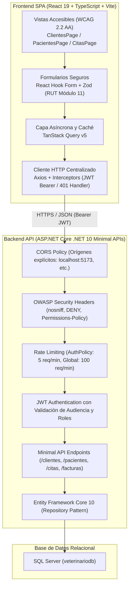

# 🐾 Sistema de Gestión Veterinaria (VetCare)
## Trabajo Práctico Nº 2: Lenguaje de Programación Web II (LPW2)

[](https://dotnet.microsoft.com/)
[](https://react.dev/)
[](https://www.typescriptlang.org/)
[](https://vitejs.dev/)
[](https://tailwindcss.com/)
[](https://www.w3.org/WAI/standards-guidelines/wcag/)

Solución full-stack modular y desacoplada para la administración clínica de un centro veterinario. El sistema implementa una API RESTful desarrollada con ASP.NET Core bajo el paradigma de Minimal APIs y un cliente Single Page Application (SPA) desarrollado con React, Vite, TypeScript y Tailwind CSS, enfocado en accesibilidad universal (WCAG 2.2 Nivel AA), seguridad OWASP y consumo HTTP asíncrono con TanStack Query.

---

## 🏗️ 1. Arquitectura del Sistema



### Componentes Clave:
- **Backend (`VeterinariaAPI`):**
  - .NET 10 Minimal APIs con patrón repositorio genérico (`IRepository<T>`) y repositorios especializados.
  - Autenticación con JWT (JSON Web Tokens) firmados con algoritmo HMAC-SHA256, con validación estricta de emisor (`Issuer`), audiencia (`Audience`), expiración (`ExpireMinutes`) y clave de firma.
  - Control de acceso por roles (*Role-Based Access Control* / RBAC) en cada endpoint (`RequireRole("Administrador", "Veterinario", "Recepcionista")`).
  - Protección de fuerza bruta en autenticación con `RateLimiter` (`AuthPolicy`: 5 peticiones por minuto).
  - Cabeceras de seguridad HTTP OWASP inyectadas de forma garantizada vía `Response.OnStarting` (`X-Content-Type-Options: nosniff`, `X-Frame-Options: DENY`, `Referrer-Policy: strict-origin-when-cross-origin`, `Permissions-Policy`).
  - Middleware de excepciones global con respuestas RFC 7807 sin filtrar rutas internas ni detalles de SQL al cliente.
  - Sembrado de datos de prueba (`DbSeeder`) condicionado explícitamente a entorno de desarrollo y protegido contra sobrescritura de contraseñas existentes.

- **Frontend (`veterinaria-client`):**
  - React 19 + TypeScript en modo estricto (`verbatimModuleSyntax: true`).
  - Enrutamiento protegido por autenticación y roles con `react-router-dom` v7.
  - Gestión de estado del servidor, caché, reintentos y mutaciones optimistas con `@tanstack/react-query` v5.
  - Validación tipada en tiempo de ejecución con `zod` y `@hookform/resolvers`, incluyendo validación estricta de RUT chileno con algoritmo Módulo 11.
  - Accesibilidad WCAG 2.2 Nivel AA: componentes con navegación por teclado, anuncios para lectores de pantalla (`aria-live`, `aria-describedby`, `role="alert"`), trampas de foco en diálogos modales (`ConfirmDialog`) y áreas táctiles mínimas de 44x44 px.
  - Diseño *Mobile-First*: vistas adaptables desde 320 px sin scroll horizontal (tarjetas estructuradas en móvil, tablas semánticas en pantallas de 768 px o más).

---

## 📋 2. Requisitos Previos

Para ejecutar la solución completa en su máquina local se requiere:

| Herramienta | Versión Mínima Requerida | Comprobación de Instalación |
| :--- | :--- | :--- |
| **.NET SDK** | .NET 10.0 (o .NET 9.0+) | `dotnet --version` |
| **Node.js** | v20.x o v24.x LTS | `node -v` |
| **npm** | v10.x u 11.x | `npm -v` |
| **Microsoft SQL Server** | SQL Server 2019 / 2022 o LocalDB / SQLEXPRESS | `sqlcmd -?` o SSMS |

---

## 🗄️ 3. Configuración de la Base de Datos

El repositorio incluye el script DDL completo `veterinariodb.sql` en la raíz del proyecto.

### Paso 1: Ejecutar el script SQL
Abra una terminal de comandos (o SQL Server Management Studio) y ejecute:

```bash
# Opción A: Usando sqlcmd con autenticación de Windows (SQLEXPRESS local)
sqlcmd -S localhost\SQLEXPRESS -E -i veterinariodb.sql

# Opción B: Si utiliza una instancia por defecto (localhost)
sqlcmd -S localhost -E -i veterinariodb.sql
```

### Paso 2: Poblar los Roles Básicos
Para garantizar la integridad referencial de los usuarios, ejecute el siguiente bloque en la base de datos `veterinariodb`:

```sql
USE [veterinariodb];
GO

IF NOT EXISTS (SELECT 1 FROM Roles WHERE Id = 1)
BEGIN
    SET IDENTITY_INSERT Roles ON;
    INSERT INTO Roles (Id, Nombre, PermisosEscritura) VALUES 
        (1, 'Administrador', 1),
        (2, 'Veterinario', 1),
        (3, 'Recepcionista', 0);
    SET IDENTITY_INSERT Roles OFF;
END
GO
```

---

## ⚙️ 4. Configuración Segura de Variables y Secretos

Para cumplir con las buenas prácticas de seguridad de OWASP, los secretos de autenticación, cadenas de conexión y contraseñas reales nunca se versionan en el repositorio.

### Opción Recomendada para Backend: .NET User Secrets
En entorno de desarrollo local, utilice la herramienta nativa de secretos de usuario de .NET, la cual almacena los valores fuera del árbol de directorios del proyecto:

```bash
cd VeterinariaAPI

# Inicializar User Secrets en el proyecto
dotnet user-secrets init

# Configurar cadena de conexión local
dotnet user-secrets set "ConnectionStrings:miconexion" "Server=localhost\SQLEXPRESS;Database=veterinariodb;Trusted_Connection=True;TrustServerCertificate=True;MultipleActiveResultSets=true;"

# Configurar clave secreta de firma JWT (mínimo 32 caracteres)
dotnet user-secrets set "Jwt:Key" "Clave_Super_Secreta_Para_Firma_JWT_Desarrollo_Local_2026_Min_32!"
dotnet user-secrets set "Jwt:Issuer" "VeterinariaAPI"
dotnet user-secrets set "Jwt:Audience" "VeterinariaClient"
dotnet user-secrets set "Jwt:ExpireMinutes" "60"

# Opcional: Activar sembrado de datos de prueba en desarrollo
dotnet user-secrets set "SeedDemoData" "true"
dotnet user-secrets set "SeedDemoPasswords:Admin" "Admin123!"
dotnet user-secrets set "SeedDemoPasswords:Vet" "Vet123!"
dotnet user-secrets set "SeedDemoPasswords:Recep" "Recep123!"
```

### Opción Alternativa: Archivo de Configuración Local o Variables de Entorno
1. Copie el archivo `VeterinariaAPI/appsettings.example.json` a `VeterinariaAPI/appsettings.json` (archivo ignorado por `.gitignore`):
   ```bash
   cp VeterinariaAPI/appsettings.example.json VeterinariaAPI/appsettings.json
   ```
2. O copie `VeterinariaAPI/.env.example` y exporte las variables mapeadas con doble guión bajo (`ConnectionStrings__miconexion`, `Jwt__Key`, etc.).

### Configuración del Frontend (`veterinaria-client/.env`)
En la carpeta `veterinaria-client`, verifique o cree el archivo `.env`:

```bash
cd veterinaria-client
cp .env.example .env
```

Contenido de `.env`:
```env
# URL base hacia la API de ASP.NET Core (puerto HTTPS local)
VITE_API_URL=https://localhost:7189/api/v1
```
*(Nota: si ejecuta el backend bajo HTTP puro, utilice `http://localhost:5021/api/v1`).*

---

## 🔐 5. Permisos Reales por Rol y Credenciales

### Matriz de Permisos por Rol (Backend Minimal APIs y Frontend SPA)

| Módulo / Recurso | Administrador | Veterinario | Recepcionista |
| :--- | :--- | :--- | :--- |
| **Clientes** (`/api/v1/clientes`) | Crear, Leer, Editar, Eliminar | Crear, Leer, Editar *(No elimina)* | Solo Lectura |
| **Pacientes** (`/api/v1/pacientes`) | Crear, Leer, Editar, Eliminar | Crear, Leer, Editar *(No elimina)* | Solo Lectura |
| **Agenda de Citas** (`/api/v1/citas`) | Crear, Leer, Editar, Eliminar | Crear, Leer, Editar, Eliminar | Crear, Leer, Editar *(No elimina)* |
| **Consultas Médicas** (`/api/v1/consultas`) | Crear, Leer, Editar, Eliminar | Crear, Leer, Editar, Eliminar | Sin Acceso (Bloqueo 403) |
| **Farmacia / Insumos** (`/api/v1/insumos`) | Crear, Leer, Editar, Eliminar | Crear, Leer, Editar *(No elimina)* | Solo Lectura |
| **Recetas** (`/api/v1/recetas`) | Crear, Leer, Editar, Eliminar | Crear, Leer, Editar *(No elimina)* | Solo Lectura |
| **Facturas y Detalles** (`/api/v1/facturas`) | Crear, Leer, Editar, Eliminar | Crear, Leer, Editar *(No elimina)* | Crear, Leer, Editar *(No elimina)* |
| **Usuarios del Sistema** (`/api/v1/usuarios`) | Gestión Total (Crear, Listar) | Sin Acceso (Bloqueo 403) | Sin Acceso (Bloqueo 403) |

### Credenciales de Demostración

- **En la API Real (Base de Datos):** Si activa `SeedDemoData: true` en su configuración local de desarrollo, el sembrador genera las cuentas iniciales protegiendo las contraseñas mediante hash seguro BCrypt. Si la cuenta ya existe en la base de datos, el sembrador nunca sobrescribe contraseñas ni datos previos.
- **En Entorno Simulado (Pruebas Vitest / MSW y Playwright):** Se utilizan interceptores en memoria con credenciales simuladas predefinidas para garantizar pruebas herméticas y deterministas sin conexión externa.

Cuentas de demostración sugeridas para el entorno local:
- **Administrador:** `admin@veterinaria.com` (Contraseña configurada en su entorno, por ejemplo: `Admin123!`)
- **Veterinario:** `vet@veterinaria.com` (Contraseña configurada en su entorno, por ejemplo: `Vet123!`)
- **Recepcionista:** `recepcion@veterinaria.com` (Contraseña configurada en su entorno, por ejemplo: `Recep123!`)

### 🔄 Restablecimiento de Contraseñas Demo (una sola vez por entorno)

Ejecuta este procedimiento **únicamente si las cuentas ya existen en la BD con hashes de contraseñas antiguas** y el login retorna 401. El mecanismo está restringido a entorno `Development` y nunca se ejecuta automáticamente en cada inicio.

```bash
# Paso 1 — Configurar las contraseñas en appsettings.json local (o con User Secrets):
#   "SeedDemoPasswords": {
#     "Admin": "Admin123!",
#     "Vet": "Vet123!",
#     "Recep": "Recep123!"
#   }
# O bien, con User Secrets (recomendado):
dotnet user-secrets set "SeedDemoPasswords:Admin" "Admin123!" --project VeterinariaAPI/VeterinariaAPI.csproj
dotnet user-secrets set "SeedDemoPasswords:Vet" "Vet123!" --project VeterinariaAPI/VeterinariaAPI.csproj
dotnet user-secrets set "SeedDemoPasswords:Recep" "Recep123!" --project VeterinariaAPI/VeterinariaAPI.csproj

# Paso 2 — Activar el restablecimiento UNA SOLA VEZ:
dotnet user-secrets set "ResetDemoPasswords" "true" --project VeterinariaAPI/VeterinariaAPI.csproj
# O en appsettings.json local: "ResetDemoPasswords": true

# Paso 3 — Arrancar la API (en Development):
dotnet run --project VeterinariaAPI/VeterinariaAPI.csproj --launch-profile https

# El log confirmará:
#   ⚠️  [DbSeeder] ResetDemoPasswords activado. Actualizando hashes y roles de cuentas demo...
#   ✅ [DbSeeder] Restablecimiento completado: 3 cuenta(s) actualizadas con sus roles.

# Paso 4 — ⚠️ IMPORTANTE: Desactívalo inmediatamente:
dotnet user-secrets set "ResetDemoPasswords" "false" --project VeterinariaAPI/VeterinariaAPI.csproj
# O en appsettings.json local: "ResetDemoPasswords": false
```

> **Nota sobre el rate limiter:** Si ves `429 Too Many Requests` antes de un `401`, significa que se superaron 5 intentos de login en menos de 1 minuto. Espera ~1 minuto para que la ventana fija se renueve automáticamente y vuelve a intentar. No es necesario reiniciar el servidor.

---

## 🚀 6. Instrucciones de Instalación y Ejecución

### Terminal 1: Backend (.NET 10 API)
Desde la raíz del repositorio:

```bash
dotnet run --project VeterinariaAPI/VeterinariaAPI.csproj --launch-profile https
```
La API iniciará en `https://localhost:7189` (y `http://localhost:5021`). La documentación interactiva OpenAPI/Scalar estará accesible en `https://localhost:7189/scalar/v1`.

### Terminal 2: Frontend (React 19 SPA)
Desde la carpeta `veterinaria-client`:

```bash
cd veterinaria-client
npm install
npm run dev
```
La aplicación web estará disponible de inmediato en:
👉 **`http://localhost:5173`**

---

## 🧪 7. Pruebas Automatizadas

El proyecto cuenta con suites de pruebas en ambos extremos de la arquitectura:

### A. Pruebas del Backend (xUnit + WebApplicationFactory)
Desde la raíz de la solución:

```bash
dotnet test
```
**12 pruebas de integración automatizadas (100% pasando):**
1. Obtención de usuarios autenticados con formato JSON válido (`Test_GetUsuarios_ReturnsSuccessAndJson`).
2. Rechazo de solicitud sin cabecera de autorización con HTTP 401 (`Test_GetUsuarios_WithoutToken_ReturnsUnauthorized`).
3. Bloqueo por rol insuficiente con HTTP 403 en gestión de usuarios (`Test_GetUsuarios_WithRecepcionistaRole_ReturnsForbidden`).
4. Bloqueo por rol insuficiente con HTTP 403 al intentar eliminar clientes (`Test_DeleteCliente_WithRecepcionistaRole_ReturnsForbidden`).
5. Rechazo de credenciales incorrectas en login con HTTP 401 (`Test_Login_InvalidCredentials_ReturnsUnauthorized`).
6. Validación de DTOs en registro con HTTP 400 Bad Request (`Test_Register_InvalidModel_ReturnsValidationProblem`).
7. Límite de tasa / Rate Limiting con HTTP 429 Too Many Requests (`Test_RateLimiting_ExceedLimit_Returns429TooManyRequests`).
8. Conflicto de clave foránea interceptado con HTTP 409 Conflict (`Test_ForeignKeyConflict_Returns409Conflict`).
9. Rechazo de token con audiencia no válida con HTTP 401 (`Test_InvalidAudience_ReturnsUnauthorized`).
10. Ocultación de detalles internos de excepción y rutas en error 500 (`Test_InternalServerError_DoesNotExposeExceptionDetails`).
11. Verificación de política CORS ante orígenes no autorizados (`Test_Cors_DisallowedOrigin_DoesNotExposeAllowOriginHeader`).
12. Presencia obligatoria de cabeceras de seguridad OWASP (`Test_SecurityHeaders_ArePresentInResponse`).

### B. Pruebas Unitarias y de Componentes del Frontend (Vitest + MSW)
Desde la carpeta `veterinaria-client`:

```bash
cd veterinaria-client
npm run test
```
**9 pruebas unitarias pasando:**
- **Autenticación:** Inicio de sesión exitoso, almacenamiento de JWT y manejo de error 401 sin romper el formulario.
- **Rutas Protegidas:** Redirección de visitantes no autenticados a `/login` y bloqueo 403 Forbidden para perfiles sin privilegios.
- **CRUD Clientes:** Listado responsivo con MSW, apertura de diálogos modales y validación estricta de formularios.

### C. Pruebas End-to-End y de Accesibilidad (Playwright)
Desde la carpeta `veterinaria-client`:

```bash
# Modo consola headless:
npm run test:e2e

# Modo interactivo con UI de Playwright:
npm run test:e2e:ui
```
**Pruebas E2E y de Accesibilidad WCAG 2.2 AA pasando:**
- Flujo crítico de usuario en escritorio (Desktop Chrome) y dispositivos móviles (Mobile Chrome).
- Escaneo automatizado de accesibilidad con `@axe-core/playwright` (0 violaciones críticas o serias en `/login`).
- Comprobación de navegación por teclado y foco visible en controles de formulario.
- Neutralización de vectores de prueba XSS en el buscador interactivo.
- Verificación no destructiva de integración con la API.

---

## 🎯 8. Guía de Demostración en Vivo de Controles

Para demostrar el cumplimiento de los controles de la rúbrica durante la evaluación en clases, ejecute el proyecto y siga estos pasos:

### Control 1: Autenticación Segura y Rechazo 401
1. Con la aplicación abierta en `http://localhost:5173/login`, ingrese un correo inexistente o contraseña errónea y presione *Iniciar sesión*.
2. Observe que la interfaz no se rompe y muestra el mensaje claro: `"Correo o contraseña incorrectos."` (respuesta HTTP 401 en la pestaña Network de DevTools).
3. Ingrese credenciales válidas (por ejemplo, cuenta de Administrador) y confirme el inicio de sesión exitoso con redirección inmediata al Dashboard.

### Control 2: Operación Permitida según Rol (RBAC)
1. Con la sesión de Administrador o Veterinario activa, diríjase a *Gestión Clínica -> Clientes*.
2. Presione *Nuevo Cliente*, complete los campos con un RUT válido (ejemplo: `12.345.678-5`), guarde el formulario y observe que el registro se añade inmediatamente a la lista.
3. Si inicia sesión como Recepcionista, diríjase a *Agenda de Citas* y confirme que puede agendar una nueva cita o emitir una boleta en *Facturación*.

### Control 3: Acceso sin Token (401 Unauthorized)
1. Abra una terminal de comandos e invoque un endpoint protegido sin incluir cabeceras de autorización:
   ```bash
   curl -k -i https://localhost:7189/api/v1/usuarios
   ```
2. Confirme que el servidor responde de inmediato con código `HTTP/1.1 401 Unauthorized` y cabeceras de seguridad.

### Control 4: Rol Insuficiente (403 Forbidden)
1. Inicie sesión con la cuenta de Recepcionista en la interfaz web y observe que los botones de eliminar y el menú de administración no son visibles.
2. Si se fuerza una petición de eliminación o de lectura administrativa utilizando el token del Recepcionista:
   ```bash
   curl -k -i -X DELETE https://localhost:7189/api/v1/clientes/1 -H "Authorization: Bearer <TOKEN_RECEPCIONISTA>"
   ```
3. Confirme que el backend responde con código `HTTP/1.1 403 Forbidden`, demostrando que la seguridad se impone en el servidor.

### Control 5: Bloqueo de CORS
1. Envíe una solicitud simulando un origen no autorizado hacia la API:
   ```bash
   curl -k -i -H "Origin: http://sitio-malicioso.com" https://localhost:7189/api/v1/clientes
   ```
2. Observe que la respuesta no contiene la cabecera `Access-Control-Allow-Origin: http://sitio-malicioso.com`, bloqueando el acceso al navegador.

### Control 6: Neutralización de Inyección XSS
1. En la vista de *Clientes* o *Pacientes*, ingrese en el campo de búsqueda de texto:
   ```html
   <script>alert("xss")</script>
   ```
2. Observe que ningún diálogo JavaScript se ejecuta y la cadena se trata como texto plano inocuo en el DOM gracias a la interpolación segura de React.

### Control 7: Límite de Tasa / Rate Limiting (429 Too Many Requests)
1. Ejecute en la terminal PowerShell 6 intentos rápidos consecutivos de inicio de sesión fallido:
   ```powershell
   1..6 | ForEach-Object { Invoke-RestMethod -Method Post -Uri "https://localhost:7189/api/v1/usuarios/login" -Body '{"email":"test@fail.com","password":"bad"}' -ContentType "application/json" -SkipCertificateCheck }
   ```
2. Confirme que a partir de la sexta petición el servidor rechaza la solicitud con código `HTTP 429 Too Many Requests`.

### Control 8: Accesibilidad Universal WCAG 2.2 AA
1. **Navegación por Teclado:** Recorra la interfaz utilizando únicamente la tecla `Tab` y `Shift + Tab`. Confirme que todos los botones, enlaces y campos reciben foco visible mediante un anillo de alto contraste (`focus-visible:ring-2`).
2. **Trampa de Foco en Diálogos Modales:** Al abrir el diálogo de confirmación de eliminación, presione `Tab` repetidamente; el foco permanecerá atrapado dentro del diálogo. Presione `Escape` y verifique que el modal se cierra devolviendo el foco al botón disparador.
3. **Zoom al 200% y Vista Móvil:** En el navegador, aumente el zoom al 200% o abra las herramientas de desarrollador en modo responsivo a 320 px de ancho. Confirme que la interfaz se adapta verticalmente mostrando tarjetas y menú hamburguesa sin generar barra de desplazamiento horizontal.

---

## 📁 9. Estructura del Repositorio

```text
├── VeterinariaAPI/               # Proyecto Web API en ASP.NET Core .NET 10
│   ├── Data/                     # Inicializador y sembrado condicional (DbSeeder)
│   ├── Endpoints/                # Minimal APIs (Clientes, Pacientes, Citas, Usuarios, etc.)
│   ├── Middlewares/              # Middleware global de excepciones y seguridad
│   ├── Models/                   # Entidades EF Core y DbContext
│   ├── Repositories/             # Patrón Repositorio genérico y especializado
│   ├── Services/                 # Servicio de autenticación con BCrypt y JWT
│   ├── Program.cs                # Configuración CORS, cabeceras OWASP, RateLimit y pipelines
│   ├── appsettings.example.json  # Plantilla de configuración con marcadores seguros
│   └── .env.example              # Variables de entorno documentadas para backend
├── VeterinariaAPI.Tests/         # 12 Pruebas de integración xUnit con WebApplicationFactory
├── veterinaria-client/           # SPA Frontend en React 19 + TypeScript + Vite
│   ├── src/
│   │   ├── api/                  # Instancia centralizada de Axios + Interceptores
│   │   ├── components/           # Componentes UI accesibles (Modal, Inputs, Navigation)
│   │   ├── context/              # Contexto de Autenticación, RBAC y control de inactividad
│   │   ├── hooks/                # Custom hooks con TanStack Query
│   │   ├── pages/                # Vistas principales (Login, Clientes, Citas, Facturación, Admin)
│   │   ├── routes/               # Rutas públicas y protegidas (ProtectedRoute)
│   │   ├── schemas/              # Esquemas de validación con Zod y algoritmo RUT Módulo 11
│   │   ├── services/             # Servicios HTTP tipados
│   │   └── test/                 # Suite de 9 pruebas Vitest + MSW
│   ├── e2e/                      # Pruebas End-to-End y de accesibilidad con Playwright y Axe
│   ├── playwright.config.ts      # Configuración de Playwright (Chromium y Mobile Chrome)
│   └── vite.config.ts            # Configuración de Vite y Vitest
├── AI_LOG.md                     # Bitácora formal de uso de Inteligencia Artificial
├── INFORME_TECNICO.md            # Informe de Arquitectura, JWT, WCAG y Matriz OWASP
├── veterinariodb.sql             # Script SQL de creación de la base de datos
└── README.md                     # Documentación principal del proyecto
```
